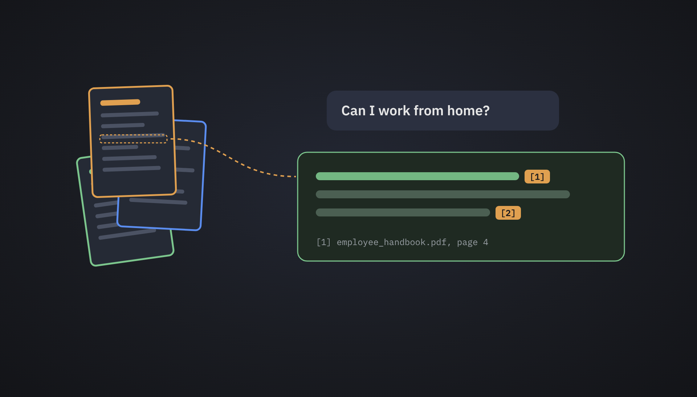
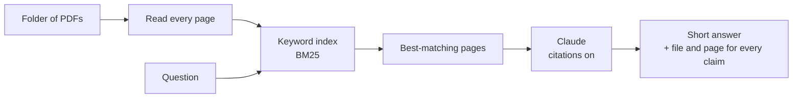
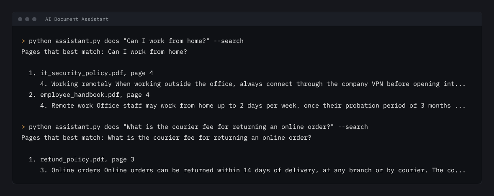

# AI Document Assistant

Ask questions about a folder of PDFs, such as policies, contracts, manuals or handbooks, and get short answers
that cite the exact file and page they came from.



## The problem

Staff waste time searching long PDFs for one rule: how many leave days, how long a refund takes, what to do if
a laptop is lost. A plain chatbot can answer confidently and wrongly. Answers about company rules have to come
from the company's own documents, with a source someone can check.

## How it works



1. **Read.** Every page of every PDF is read and indexed. No database or search service is needed.
2. **Find.** The pages that best match the question are picked with BM25 keyword scoring. Pages that only
   share a common word with the question are dropped.
3. **Answer.** Only those pages are sent to Claude, each as a separate document with citations turned on.
   Claude answers only from them, and says so when they don't contain the answer.
4. **Cite.** Every claim in the answer comes back with the file, the page and the exact sentence it is based on.

Because only a few pages are sent, never the whole folder, each question stays fast and cheap even when the
folder is large.

## Run it

```bash
pip install -r requirements.txt
python make_sample_docs.py                     # creates docs/ with 3 sample policy documents
python assistant.py docs "Can I work from home?" --search
```

`--search` shows which pages would be sent, and works without an API key:



To get answers, set an Anthropic API key and drop `--search`:

```bash
export ANTHROPIC_API_KEY=...                   # Windows: set ANTHROPIC_API_KEY=...
python assistant.py docs "How many days of annual leave do I get?"
```

The answer is printed with numbered markers, followed by its sources:

```text
<the answer, with a marker such as [1] after each claim>

Sources:
  [1] <file>, page <n>: "<the exact sentence the claim is based on>"
```

To use your own documents, point it at another folder: `python assistant.py path/to/pdfs "your question"`.
Options: `--pages 6` sends more pages with each question, and `--model` picks the Claude model.

## The sample documents

`make_sample_docs.py` writes three documents for a fictional retailer, Sinai Retail Group: an employee handbook,
a customer refund policy and an IT security policy (14 pages in total). Questions to try:

- How many days of annual leave do I get?
- What should I do if I lose my laptop?
- Can I return opened electronics?
- How long do card refunds take?
- What is the meal allowance when travelling?

## Design choices

- **Citations, not a summary of everything.** Each page is sent as its own document titled with its file and
  page number, so the API's citations point straight at a page a person can open and check.
- **Refusals are handled.** If the model declines a request, the API retries it on a fallback model in the same
  call (`fallbacks: "default"`). If the whole chain declines, the tool says so instead of printing an empty answer.
- **Clear errors.** A missing or wrong API key, a rate limit or a network problem each get a plain message.

## Tests

```bash
pytest
```

The tests build the sample documents, check that search puts the right page first for real questions, and run the
real Anthropic SDK against a fake API. That checks the exact request (documents, citations, the question last,
the fallback setting) and that cited answers and refusals are read correctly. No API key or network is needed.

## Built with

Python · Anthropic API (Claude, citations) · pdfplumber · BM25 search · reportlab (sample documents) · pytest

## Need an AI assistant for your documents?

I build tools like this for clients: assistants that answer from your own policies, manuals, contracts or
product catalogues, with a source for every answer. Tell me what documents you have and who will ask the questions.

<a href="https://www.upwork.com/freelancers/~01b6c711b0162ca691"></a>
<a href="mailto:mazen.elnaghy@gmail.com"></a>

Built by [Mazen Elnaghy](https://github.com/mazenelnaghy-code) · [Portfolio](https://mazenelnaghy-code.github.io)
